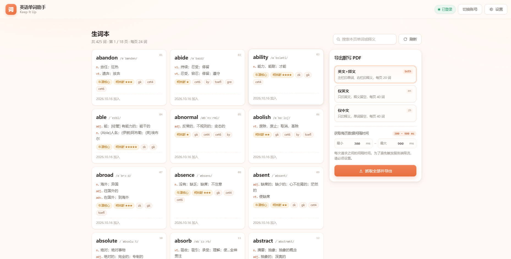

# 英语单词助手

> 一站式导出「不背单词」生词本，并生成pdf。登录 + 导出一键搞定。



---


## 目录
- [一、这个项目能做什么](#一这个项目能做什么)
- [二、快速开始](#二快速开始)
  - [1. 环境要求](#1-环境要求)
  - [2. 安装依赖](#2-安装依赖)
  - [3. 下载离线词典（必须）](#3-下载离线词典必须)
  - [4. 启动](#4-启动)
- [三、使用教程](#三使用教程)
  - [1、前置条件：](#1前置条件)
  - [2、登录](#2登录)
  - [3、浏览生词本](#3浏览生词本)
  - [4、导出 PDF](#4-导出-pdf)
- [四、前端](#四前端)
  - [启动](#启动)
- [五、技术结构（简）](#五技术结构简)
- [六、F&Q](#六fq)
  - [隐私与免责](#隐私与免责)
  - [许可](#许可)
  - [致谢](#致谢)

---
## 一、这个项目能做什么

1. 获取「不背单词」的生词本数据
2. 导出生词本中的数据制作成pdf

**亮点：**
1. 导出一站式：登录 + 导出本项目一键搞定。
2. 还原「不背单词」导出模板样式与模式（中文+英文，仅中文，仅英文）
3. 离线翻译，基于[ECDICT](https://github.com/skywind3000/ECDICT-ultimate)库进行翻译
4. 集成vue前端，用户可以在web上进行操作，非常方便
5. 持续维护中，后续会加入更多功能！

> 声明：本项目与「不背单词」官方无关，仅通过其网页端接口读取你本人账号下的生词本，不提供任何破解或代登录服务。

---

## 二、快速开始

### 1. 环境要求

- **Python 3.12+**
- 能访问 `bbdc.cn`与 GitHub（首次下载词典）
- 推荐用 [uv](https://docs.astral.sh/uv/) 管理依赖；用 pip 也可以
- **Node.js 20+**（只有需要网页界面时才要装；纯调 API 可以跳过）

### 2. 安装依赖

```bash
# 方式一：uv（项目自带 uv.lock，一键装齐，推荐）
uv sync
uv run python -m app.main        # 用 uv 运行时前面加 uv run

# 方式二：pip
python -m venv .venv
source .venv/bin/activate        # Windows: .venv\Scripts\activate
pip install aiofiles ddddocr fastapi httpx pydantic pyyaml reportlab requests sse-starlette uvicorn
```

> 项目没有配置构建后端（`build-system`），所以 `pip install -e .` 会因为自动发现包失败而报错。直接按上面的依赖列表安装即可，源码不需要装进环境。

### 3. 下载离线词典（必须）

释义来自 **ECDICT-ultimate** 的 SQLite 版本。项目**不附带**这个数据库，需要自己下载一次：

**下载地址**

<https://github.com/skywind3000/ECDICT-ultimate/releases/download/1.0.0/ecdict-ultimate-sqlite.zip>

**放到项目根目录下的 `translate/ultimate.db`**

下载 zip → 解压 → 把里面的 `ultimate.db` 拖进项目的 `translate/` 文件夹。

最终目录应该长这样：

```
项目根目录/
├── app/
├── config/
├── fonts/
├── web/
└── translate/
    └── ultimate.db      ← 必须有这个文件
```

> **为什么这步不能省**：启动时 `StarDict` 会用 `sqlite3.connect()` 打开这个路径。文件不存在时 SQLite 会**静默新建一个空库**，查词全部返回空，接口随即报错。所以看到「释义拿不到 / 接口 500」，先回来检查这个文件。
>
> 需要换词典也可以：任何兼容 ECDICT 表结构（`stardict` 表）的 SQLite 文件都可以直接替换 `translate/ultimate.db`。

### 4. 启动

先启动后端（它只提供 API，没有界面显示）：

```bash
# uv
uv run python -m app.main

# 或者已激活虚拟环境
python -m app.main
```

默认监听 `http://127.0.0.1:20056`。此时能打开的是接口文档，而不是界面：

```
http://127.0.0.1:20056/docs
```

改端口或监听地址，编辑 `config/config.yaml`：

```yaml
web:
  host: 127.0.0.1
  port: 20056
```

然后**另开一个终端**启动前端

```bash
cd web
npm install
npm run dev
```

> 只想调接口、不需要界面的话，走到上一步就够了。

---

## 三、使用教程

### 1、前置条件：
在[不背单词生词本](https://bbdc.cn/newword)（或手机app）中添加单词到生词本

***注意：***

1.必须添加到默认的单词本，即生词本中，否则获取不到数据。

2.数据可能有延迟，只有[不背单词生词本页面](https://bbdc.cn/newword)中显示了单词，本项目才可接收到。


### 2、登录

支持两种登录模式：`微信扫码登录`与`手机号登录`

登录成功后，登录凭证会存储在本地[cookie.pkl](/cookies/cookies.pkl)。

### 3、浏览生词本

生词本展示数据包括：单词、音标、按词性拆分的释义、柯林斯星级 / 牛津核心 / 四六级等标签，以及加入日期。

### 4、导出 PDF

3种导出模式：**英文+释义**，**仅英文**，**仅中文**


---

## 四、前端

> 前端全权由Ai编写，前端详细信息请看[README](web/README.md)

- 技术栈：Vue 3 + TypeScript + Vite 6 + vue-router
- PDF 引擎：项目内自实现的 TrueType 子集化 + PDF 写入
- 目录结构、接口契约、环境变量、缓存策略：见 **[`web/README.md`](web/README.md)**&#8203;

### 启动

```bash
cd web
npm install
npm run dev
```

后端默认`127.0.0.1:20056`不在默认地址时，用环境变量指定：

```bash
VITE_API_TARGET=http://192.168.1.10:20056 npm run dev
```
---

## 五、技术结构（简）

```
app/
├── main.py                  # 启动入口（uvicorn）
├── api/
│   ├── app.py               # FastAPI 实例、lifespan（初始化 httpx / 词典连接）
│   ├── static_web.py        # 挂载 output/ 静态目录（二维码、验证码图片）
│   └── routers/
│       ├── bbdc_login.py    # 登录相关路由（二维码走 SSE）
│       └── bbdc_newword.py  # 生词本分页路由
├── services/bbdc_service.py # 业务编排：登录、验证码、抓词、查词补全
├── oper/
│   ├── httpx_oper.py        # httpx 封装（UA、超时、JSON）
│   └── ultimate_oper.py     # StarDict：ECDICT SQLite 查询层
├── repositories/            # Cookie 持久化、文件写入
├── domain/                  # Word / UltimateResult 数据模型
└── util/generate_pdf_util.py# 服务端 PDF 版式参考实现（reportlab）

web/                         # 前端（Vue 3 + Vite + TypeScript，构建产物不进仓库）
├── index.html               # Vite 入口
├── package.json
├── vite.config.ts           # dev server + /bbdc、/output 反向代理
├── src/
│   ├── views/               # 登录页、生词本页
│   ├── components/          # 二维码面板、导出面板、词卡、分页等
│   ├── api/                 # 接口封装（统一返回体、超时、错误归类）
│   ├── lib/                 # 抓取器、导出编排、PDF 引擎与 TrueType 子集化
│   ├── stores/              # 登录态、设置（localStorage）、提示队列
│   └── assets/fonts/        # 思源黑体（Noto Sans SC）
└── dist/                    # 构建产物（.gitignore，不提交）

```

 接口一览

| 方法   | 路径                                | 说明                    |
| ---- | --------------------------------- | --------------------- |
| GET  | `/bbdc/login/qrcode`              | 微信扫码登录，SSE 推送状态与二维码路径 |
| POST | `/bbdc/login/phone`               | 手机号 + 图形码 + 短信码登录     |
| GET  | `/bbdc/login/getAuthCode`         | 获取图形验证码图片与 token      |
| POST | `/bbdc/login/getPhoneCode`        | 发送短信验证码               |
| POST | `/bbdc/login/autoLogin`           | 检测本地 Cookie 是否仍有效     |
| GET  | `/bbdc/service/getNewword/{page}` | 分页生词（含 ECDICT 释义）     |
| GET  | `/output/...`                     | 二维码、验证码图片等静态文件        |

统一返回体：`{ code, message, data }`。

## 六、F&Q

**Q：接口 500，释义是空的 / 一打开生词本就报错？**  
九成是 `translate/ultimate.db` 没放好。确认文件名完全一致（不是 `ecdict.db`、不是套了一层文件夹），且项目根目录下确实是 `translate/ultimate.db`。

**Q：二维码图片显示不出来？**  
确认是通过 `http://127.0.0.1:20056` 访问（后端会自动把 `output/` 挂到 `/output`）。图片实际保存在 `output/qrcode/qrcode.jpg`，前端也提供了「复制路径」的兜底方案。

**Q：抓到一半断了，或者提示请求过于频繁？**  
把导出面板里的间隔调大（比如 800–1500 ms）再试。已抓页面会保留，重新导出不用从头来。

**Q：为什么导出 PDF 第一次特别慢？**  
首次要下载约 10 MB 的思源黑体并解析，之后浏览器缓存会复用。这是为了保证中文在任何设备上都能正常显示（不嵌入字形的 PDF 在手机上常显示为空白）。

**Q：端口被占用？**  
改 `config/config.yaml` 里的 `port`，重启即可。

**Q：登录态突然失效？**  
上游 Cookie 有有效期。点「切换账号」重新登录；也可以直接删掉 `cookies/cookies.pkl` 再登录一次。

**Q：为什么这里的释义可能和「不背单词」里看到的不一样？**  
因为翻译的来源不同，本项目基于开源库[ECDICT](https://github.com/skywind3000/ECDICT-ultimate)获得翻译数据，因此和不背单词的官方翻译有出入

---

### 隐私与免责

- Cookie 以 pickle 形式**仅保存在本机** `cookies/cookies.pkl`，不会上传到任何服务器。请不要把这个文件提交到 Git 或分享给别人。
- 二维码、验证码图片写在 `output/` 下，属于临时文件，可随时清理。
- 本工具通过「不背单词」网页端接口读取**本人账号**的数据，请控制抓取频率，避免对上游服务造成压力。
- 仅供个人学习、复习使用。请勿用于商业用途、批量采集或再分发他人词表。

### 许可

- 本项目代码：MIT（见 `LICENSE`）
- ECDICT 数据：MIT，版权归 Linwei / skywind3000 及贡献者（见 `LICENSES/ECDICT-MIT.txt`）
- 思源黑体 Noto Sans SC：SIL Open Font License 1.1（见 `LICENSES/NotoSansSC-OFL.txt`）

### 致谢

本项目的释义、音标补充、词性、柯林斯星级、牛津核心标记、考试标签、词频等信息，全部来自开源项目 **ECDICT-ultimate**：

- 项目主页：<https://github.com/skywind3000/ECDICT-ultimate>
- 本项目使用的数据：<https://github.com/skywind3000/ECDICT-ultimate/releases/download/1.0.0/ecdict-ultimate-sqlite.zip>

ECDICT 由 **skywind3000** 创建并长期维护，是中文社区里质量与覆盖度都很出色的离线英汉词典数据。**感谢作者与所有贡献者。**

数据来源的边界请留意：

- ECDICT 本身是对多部开源词典数据的整理与合并，其版权与许可遵循上游约定（见 `LICENSES/ECDICT-MIT.txt`）
- 本项目只读取你本地这份 `ultimate.db`，**不分发、不转售**词典数据
- 若你二次分发本项目的成品或衍生数据，请自行确认符合 ECDICT 及其上游词典的许可要求